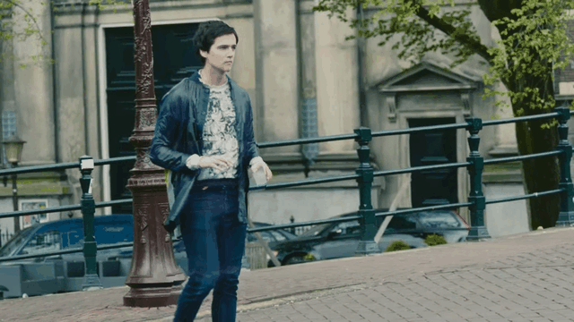
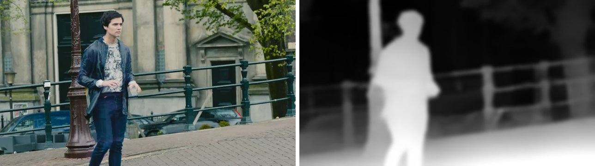
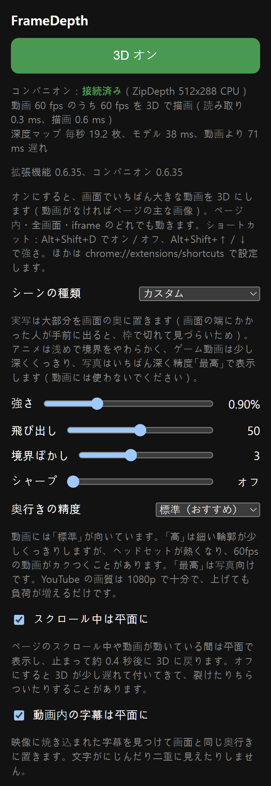

# FrameDepth

**Steam Frame** ヘッドセットの Chrome で見る動画や画像を、リアルタイムに 3D にします。

いつもの Chrome ウィンドウで、動画が再生されているその場所を立体にします。ページ内のプレーヤーでも、全画面でも、ほかのサイトから埋め込まれたプレーヤー（iframe）でも動きます。動画がなければ、ページの主な画像（ギャラリー、サムネイル一覧）を立体にします。文字やページのほかの部分は平面のままくっきり表示され、ウィンドウを動かしても、傾けても、スクロールしても 3D が追従します。

[English](README.md) | [한국어](README.ko.md) | 日本語

<p align="center"></p>
<p align="center"><sub>平面の動画の 1 場面から FrameDepth が作った左右の目を交互に表示しています。<i>Tears of Steel</i> (c) Blender Foundation, mango.blender.org, CC-BY 3.0.</sub></p>

> **実験段階です。** Steam Frame 1 台（SteamOS 0.4.5）でのみテストしています。ご利用は自己責任でお願いします。立体映像は人によって目の疲れや不快感を引き起こすことがあります。その場合は強さを下げるか 3D をオフにして（Alt+Shift+D）、休憩をとりながらご覧ください。

> FrameDepth は非公式の独立したプロジェクトであり、Valve、Google、または対応するいずれのウェブサイトとも関係がなく、承認も受けていません。Steam、Steam Frame、SteamVR、SteamOS は Valve Corporation の、Chrome は Google LLC の商標です。そのほかの名称はそれぞれの所有者に帰属します。

## 仕組み

ヘッドセット上で 2 つの部分が連携して動きます。

- **拡張機能**（`extension/`、Chrome Manifest V3）：ページの中から 3D にする動画や画像を見つけ（サイトごとのルールは不要）、その位置と、上に描かれた再生ボタンや字幕の位置をコンパニオンに伝え続けます。
- **コンパニオン**（`companion/`、systemd ユーザーサービス）：Chrome ウィンドウのその部分を読み取り、ZipDepth モデルで奥行きを推定し、左右の目の画像を GPU で作って、動画の位置に SteamVR オーバーレイとして表示します。

データが端末の外に出ることはありません。拡張機能は `127.0.0.1` のコンパニオンとだけ通信し、コンパニオンは 127.0.0.1 でのみ接続を受け付け、ウェブページからの接続は拒否します（拡張機能の Origin を確認）。


<sub>左：Chrome が表示している場面。右：FrameDepth が推定した奥行き（明るいほど近い）。<i>Tears of Steel</i> (c) Blender Foundation, CC-BY 3.0.</sub>

詳しい説明：[docs/how-it-works.md](docs/how-it-works.md)（英語）

## 機能



- 画面でいちばん大きな動画を 3D に：ページ内、全画面、iframe
- 動画がなければ、ページの主な画像 1 枚または複数枚を 3D に
- 再生ボタン・字幕・ページのダイアログを自動で見つけて平面に保つ（二重に見えない）。Chrome のメニューや拡張機能のポップアップもきれいに見える
- 曲面・平面・傾けたウィンドウに追従。スクロールの間は平面で表示し、止まると 3D に戻る（オフにできる）
- 動画の黒帯（ワイド映画、4:3 の番組）は平面にし、内側の映像だけに立体感を付ける
- ウィンドウを大きくしても近づけても、立体の差を約 1° 以内に保つ
- 止まった場面の奥行きの揺れを抑え、近くの物体の輪郭を整える
- すでに 3D の動画（左右・上下）を認識してそのまま表示。動画内の字幕は平面に保つ（オフにできる）
- シーンの種類（実写、アニメ、ゲーム動画、写真）で複数の設定をまとめて変更。種類ごとに自分の値を保存したり、既定値に戻したりできる
- ポップアップの設定：強さ、飛び出し、境界ぼかし、シャープ、奥行きの精度（標準・高は CPU、最高は写真向けに GPU）
- 画面の言語：英語、韓国語、日本語

## 必要なもの

- SteamOS と SteamVR が動く Steam Frame
- Flathub の Chrome（`com.google.Chrome`）
- 開発者モード、ヘッドセットの SSH またはターミナル

ホームフォルダーにだけインストールするため、`sudo` は不要です（SteamOS はルートファイルシステムが読み取り専用です）。

## リリース版をインストール（ヘッドセット上で）

[Releases](https://github.com/guix8/framedepth/releases) から `framedepth-バージョン-steamos-arm64.tar.gz` と `.sha256` ファイルをヘッドセットのダウンロードフォルダーに保存し、ヘッドセットのターミナルで実行します。

```bash
cd ~/Downloads && f=$(ls -v framedepth-*-steamos-arm64.tar.gz | tail -1) && echo "$f"   # いちばん新しいダウンロード
sha256sum -c "$f.sha256" && tar -xzf "$f" && cd "${f%.tar.gz}"
bash install.sh                # ~/.local/share/framedepth、ユーザーサービス、拡張機能のファイル
```

ビルドは不要です。続けて[拡張機能を読み込む](#拡張機能を読み込む)へ進みます。

## ソースからビルド（ヘッドセット上で）

ヘッドセット（aarch64）に git、curl、cmake、ninja、clang、pkg-config、X11（`x11`、`xext`、`xdamage`）・EGL/OpenGL・Vulkan の開発用ファイル、ネットワーク接続（LiteRT のビルドが依存関係を取得します）、約 0.5 GB のディスク容量が必要です。

```bash
git clone https://github.com/guix8/framedepth.git && cd framedepth
bash scripts/fetch-deps.sh     # 固定されたソースを build-deps/ へ
bash scripts/build.sh          # LiteRT と ncnn は最初の一度だけ（時間がかかる）、そのあとコンパニオン
bash packaging/install.sh      # ~/.local/share/framedepth、ユーザーサービス、拡張機能のファイル
```

`bash packaging/make-release.sh` はビルド結果を `dist/` にリリース用アーカイブとしてまとめます。`bash scripts/fetch-litert-sources.sh && bash packaging/make-source-bundle.sh` はそのビルドに使ったサードパーティのソースをまとめます（リリースごとに一緒に公開します）。

## 拡張機能を読み込む

1. Chrome で `chrome://extensions` を開き、**デベロッパー モード**をオンにします。
2. **パッケージ化されていない拡張機能を読み込む**を押し、`~/Downloads/framedepth-extension` を選びます。install.sh がコピーしたフォルダーです（アーカイブ内の `extension` フォルダーではありません）。Chrome はこのフォルダーから FrameDepth を動かすので、削除しないでください。
3. 拡張機能（パズルのピース）メニューで FrameDepth を固定し、押して 3D をオンにします（Alt+Shift+D）。

ポップアップを開けない全画面では、3D がオンのとき Alt+Shift+↑／↓ で強さを変えられます。飛び出しのショートカットは `chrome://extensions/shortcuts` で設定できます。ほかの拡張機能が使っているキーは Chrome が外すので、キーが割り当てられたかもそこで確認してください。

**更新：** リリース版は新しいアーカイブを取得し、その中の `install.sh` をもう一度実行します。ソースからの場合は `git pull` のあと `fetch-deps.sh`、`build.sh`、`packaging/install.sh` をもう一度実行します。そのあと `chrome://extensions` で FrameDepth を再読み込みします。コンパニオンはインストールしてすぐ新しくなりますが、Chrome は再読み込みするまで前の拡張機能を使うためです（バージョンが違うとポップアップが知らせます）。

**削除：** まず `chrome://extensions` で FrameDepth を削除し（先にフォルダーがなくなると Chrome がエラーを表示します）、`bash ~/.local/share/framedepth/uninstall.sh` を実行します。Chrome の Steam ショートカットが下のランチャーを使っている場合は、それも元に戻します（uninstall.sh が知らせます）。ダウンロードしたアーカイブと展開したフォルダーは自分で削除してください。

## おすすめ：Steam ライブラリから Chrome を起動

Chrome を非 Steam ゲームとして Steam ライブラリに登録して起動すると、レーザーがマウスとして動きます。

- トリガー：左クリック（押したままドラッグで文字を選択）
- サムスティック押し込み：右クリック
- サムスティック上下：スクロール（下の補助プログラムが必要）

Steam の外で起動すると、レーザーはタッチとして動きます。ドラッグすると文字の代わりにページがスクロールし、長押しすると右クリックの代わりに Chrome のタッチメニューが開きます。

Steam から起動した Chrome には直すところが 2 つあり、FrameDepth と一緒にインストールされるランチャーが両方を行います。

- **ウィンドウの大きさ：** Steam は 1280×720 のウィンドウで開きます。1920×1080 のウィンドウを倍率 150% にすると、レイアウトと文字の大きさはそのままで画素が 1.5 倍になります。文字がくっきりし、3D にする動画の画素も 2.25 倍になります（ページ内の YouTube プレーヤーで 859×483 → 1289×725）。ランチャーがこうするのは、Steam がアプリに 1920×1080 の画面を渡すときだけです。SteamOS 0.5 ベータでは画面が 1280×720 で、ウィンドウを大きくするとレーザーが一部に届かなくなるため、そのときは 1280×720・100% のままにします。
- **スクロール：** サムスティックのスクロールはほとんどページに届きません。レーザーとスクロールが別々の入力デバイスから来るため、切り替わるたびに Chrome がスクロールを捨ててしまうからです。小さな補助プログラムがそれを送り直し、Chrome が動いている間だけ動きます。

設定は一度だけです。

1. Google Chrome を非 Steam ゲームとしてライブラリに追加します（まだの場合）。
2. Chrome の **プロパティ → ショートカット** で：
   - ターゲット：`"/home/steamos/.local/share/framedepth/steam-chrome/chrome-with-scroll.sh"`
     （ホームフォルダーが違う場合は `/home/steamos` を変えます）
   - 起動オプション：`"/usr/bin/flatpak" run --branch=stable --arch=aarch64 --command=/app/bin/chrome --file-forwarding com.google.Chrome @@u @@`
     （Steam が入れた Chrome のコマンドの前に `"/usr/bin/flatpak"` を付けたもの）
3. Chrome を完全に終了し、ライブラリから起動します。

- **ウィンドウの大きさだけ変える**（補助プログラムなし）：ターゲットはそのままにして、起動オプションの `com.google.Chrome` のすぐ後ろ（`@@u @@` の前）に `--window-size=1280,720 --window-position=0,0 --force-device-scale-factor=1.5` を入れます。`--window-size` は倍率をかける前の大きさなので、`1280,720` で 1920×1080 になります。
- **元に戻す：** ターゲットを `"/usr/bin/flatpak"` に戻し、起動オプションの先頭の `"/usr/bin/flatpak"` を外します。
- **補助プログラムの制限：** Chrome が元のスクロールもときどき（約 2%）受け取るため、少し多くスクロールすることがあります。SteamOS の更新でスクロールの問題が直ると二重にスクロールすることがあるので、そのときは元に戻してください。Chrome が動いている間に Steam からもう一度起動しても、動いているウィンドウに切り替わるだけで、最初の補助プログラムが動き続けます。

## トラブルシューティング

ポップアップの一番上に、接続状態、3D が表示されない理由、動作の数値が出ます。

- 「未接続」：コンパニオンが動いていません。状態を確認し、再起動後も起動するように有効にして起動します。
  ```bash
  systemctl --user status framedepth-companion --no-pager
  systemctl --user enable --now framedepth-companion
  systemctl --user restart framedepth-companion
  ```
- 「Failed to connect to user scope bus」（インストール時や上の `systemctl` で）：シェルにログインセッションがない場合で、`su` や `sudo -u` の後に起きます。ヘッドセットにログインしているアカウントのターミナルを開くか、先に `export XDG_RUNTIME_DIR=/run/user/$(id -u)` を実行してから、もう一度 `install.sh` を実行してください。
- 「バージョンが違います」：`chrome://extensions` で FrameDepth を再読み込みします。
- 「Chrome のウィンドウが SteamVR にありません」：3D は、SteamVR をオンにしたヘッドセットの中で動く Chrome（ダッシュボードまたは Steam ライブラリから起動）の上にだけ表示されます。デスクトップや外部ディスプレイでは表示されません。
- 「別の Chrome プロファイルが使用中」：一度に使えるのは 1 つのプロファイルだけです。もう一方で 3D をオフにするか、閉じてください。
- 「エラー」：たいていは奥行きモデルが起動しなかった場合です。コンパニオンを再起動し、続く場合はもう一度インストールしてください。
- 何も起きない：動画は 200×112 ピクセル以上、写真は 1 枚なら画面の約 5 分の 1、複数なら各 120×68 ピクセル以上で、画面に見えている必要があります。
- 動画がカクつく：奥行きの精度を「標準」にします。

コンパニオンのログに詳しく出ます。

```bash
journalctl --user -u framedepth-companion -n 50 --no-pager
```

問題を報告するときは、ポップアップの一番上の状態とバージョンの行、このログ、SteamOS のバージョン（設定 → システム）を添えてください。

## ヒント

- 動画には奥行きの精度 **標準**（既定値）と YouTube 1080p が向いています。コンパニオンは Chrome が描いた画面をウィンドウの解像度で読み取るため、1440p 以上にしても 3D はくっきりせず、デコードの負荷が増えるだけです。大事なのはウィンドウの解像度で、1920×1080・倍率 150% がおすすめです（上の Steam ライブラリからの起動を参照）。
- **高** は輪郭が細かくなりますが、CPU をおよそ 1 コア多く使い、発熱が増え、奥行きが動きに少し遅れて付いてきます。装着中は 60fps の動画がときどき 45〜50fps に落ちました。**最高** は GPU を SteamVR と分け合うため写真向けです。
- 強さの既定値は立体映画と同じくらいの奥行きです（実写 0.9%）。もっと深くしたければスライダーで上げ、目が疲れたら下げてください。

## 状態と制限

初期段階で、ヘッドセット 1 台でテストしています。既知の制限：

- DRM で保護されたプレーヤーは、Chrome がウィンドウの読み取りを許可する場合だけ動きます。
- キャンバスに描かれたプレーヤーのボタンは見つけられません。
- タブごとに 3D にする領域は 1 つです。
- 3D がオンの間はページのタイトルに目印が一時的に付くため、ページから拡張機能がインストールされていることが分かります。
- 拡張機能は短い診断ログを端末内の自分のストレージにだけ残します（サイト名は含まず、どこにも送信しません）。

詳しくは [docs/how-it-works.md](docs/how-it-works.md#limits) を見てください。

## ライセンス

Copyright 2026 FrameDepth contributors. GPL-3.0-only（[LICENSE](LICENSE)）。FrameDepth は Moonlight XR（Sean Gilleece）とその Steam Frame 移植版 Moonlight XR for Frame（simplysanatori）の GPL-3.0 のコードとアイデア、そして ZipDepth モデル（MIT）をもとにしています。サードパーティのコンポーネントとライセンス：[THIRD_PARTY.md](THIRD_PARTY.md)。
