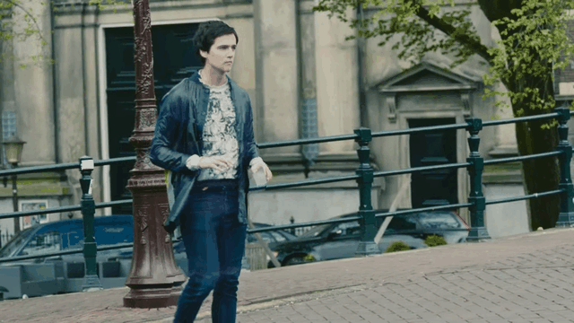
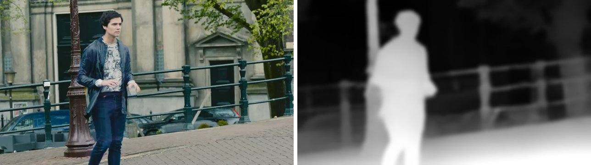
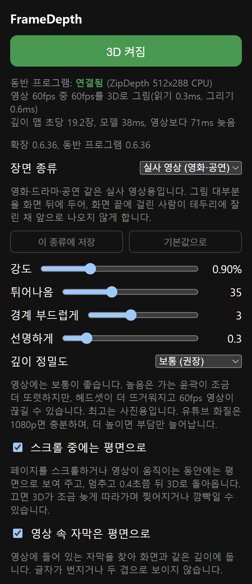

# FrameDepth

**Steam Frame** 헤드셋에서 Chrome으로 보는 영상과 사진을 실시간으로 3D로 바꿉니다.

평소 쓰는 Chrome 창에서, 영상이 재생되는 바로 그 자리에 입체로 보여 줍니다. 페이지 안 플레이어, 전체화면, 다른 사이트에서 가져온 플레이어(iframe) 모두 됩니다. 영상이 없으면 페이지의 주요 사진(갤러리, 썸네일 목록)을 바꿉니다. 글자와 나머지 페이지는 평면 그대로 또렷하고, 창을 옮기거나 기울이거나 스크롤해도 3D가 따라갑니다.

[English](README.md) | 한국어 | [日本語](README.ja.md)

<p align="center"></p>
<p align="center"><sub>평면 영상 한 장면으로 FrameDepth가 만든 왼쪽·오른쪽 눈을 번갈아 보여 줍니다. <i>Tears of Steel</i> (c) Blender Foundation, mango.blender.org, CC-BY 3.0.</sub></p>

> **실험 단계입니다.** Steam Frame 한 대(SteamOS 0.4.5)에서만 시험했으며, 사용에 따른 책임은 사용자에게 있습니다. 입체 영상은 사람에 따라 눈이 피로하거나 불편할 수 있습니다. 그럴 때는 강도를 낮추거나 3D를 끄고(Alt+Shift+D) 쉬어 가며 보세요.

> FrameDepth는 비공식 독립 프로젝트로, Valve·Google이나 함께 쓰는 어떤 웹사이트와도 관련이 없고 보증을 받지 않았습니다. Steam, Steam Frame, SteamVR, SteamOS는 Valve Corporation의, Chrome은 Google LLC의 상표입니다. 그 밖의 이름은 각 소유자의 것입니다.

## 동작 방식

헤드셋에서 두 부분이 함께 돌아갑니다.

- **확장 프로그램**(`extension/`, Chrome Manifest V3): 페이지에서 3D로 바꿀 영상이나 사진을 찾아(사이트별 규칙 없음), 그 위치와 위에 그려진 재생 버튼·자막의 위치를 동반 프로그램에 계속 알립니다.
- **동반 프로그램**(`companion/`, systemd 사용자 서비스): Chrome 창에서 그 부분을 읽어 ZipDepth 모델로 깊이를 추정하고, 왼쪽·오른쪽 눈 그림을 GPU로 만들어 영상 자리에 SteamVR 오버레이로 띄웁니다.

데이터는 기기 밖으로 나가지 않습니다. 확장은 `127.0.0.1`의 동반 프로그램하고만 통신하고, 동반 프로그램은 127.0.0.1에서만 접속을 받으며 웹 페이지의 접속은 거부합니다(확장의 Origin 확인).


<sub>왼쪽: Chrome이 보여 주는 장면. 오른쪽: FrameDepth가 추정한 깊이(밝을수록 가까움). <i>Tears of Steel</i> (c) Blender Foundation, CC-BY 3.0.</sub>

자세한 설명: [docs/how-it-works.md](docs/how-it-works.md)(영어)

## 기능



- 화면에서 가장 큰 영상을 3D로: 페이지 안, 전체화면, iframe
- 영상이 없으면 페이지의 주요 사진 한 장 또는 여러 장을 3D로
- 재생 버튼·자막·페이지 대화상자는 자동으로 찾아 평면으로 둠(두 겹으로 보이지 않음). Chrome 메뉴와 확장 팝업도 깨끗하게 보임
- 곡면·평면·기울인 창을 따라감. 스크롤하는 동안은 평면으로 보여 주고 멈추면 다시 3D로(팝업에서 끌 수 있음)
- 영상 속 검은 띠(와이드 영화, 4:3 방송)는 평면으로 두고 띠 안쪽에만 입체를 줌
- 창을 키우거나 가까이 둬도 입체 차이를 약 1° 안으로 유지
- 멈춘 장면의 깊이 흔들림을 줄이고 가까운 물체의 윤곽을 다듬음
- 이미 3D인 영상(좌우·위아래)은 알아보고 그대로 보여 줌. 영상에 들어 있는 자막은 평면으로(팝업에서 끌 수 있음)
- 장면 종류(실사 영상, 애니메이션, 게임 영상, 사진)로 여러 설정을 한 번에 바꿈. 종류마다 내 값을 저장하거나 기본값으로 되돌릴 수 있음
- 팝업 설정: 강도, 튀어나옴, 경계 부드럽게, 선명하게, 깊이 정밀도(보통·높음은 CPU, 최고는 사진용으로 GPU)
- 화면 언어: 영어, 한국어, 일본어

## 필요한 것

- SteamOS와 SteamVR이 도는 Steam Frame
- Flathub의 Chrome(`com.google.Chrome`)
- 개발자 모드, 그리고 헤드셋의 SSH 또는 터미널

홈 폴더에만 설치하므로 `sudo`는 필요 없습니다(SteamOS는 루트 파일 시스템이 읽기 전용입니다).

## 설치(배포 파일)

[Releases](https://github.com/guix8/framedepth/releases)에서 `framedepth-버전-steamos-arm64.tar.gz`와 `.sha256` 파일을 헤드셋의 다운로드 폴더에 받고, 헤드셋 터미널에서 실행합니다.

```bash
cd ~/Downloads && f=$(ls -v framedepth-*-steamos-arm64.tar.gz | tail -1) && echo "$f"   # 가장 최근 받은 파일
sha256sum -c "$f.sha256" && tar -xzf "$f" && cd "${f%.tar.gz}"
bash install.sh                # ~/.local/share/framedepth, 사용자 서비스, 확장 파일
```

빌드할 것은 없습니다. 이어서 [확장 로드](#확장-로드)로 넘어갑니다.

## 소스에서 빌드(헤드셋에서)

헤드셋(aarch64)에 git, curl, cmake, ninja, clang, pkg-config, X11(`x11`, `xext`, `xdamage`)·EGL/OpenGL·Vulkan 개발 파일, 네트워크 연결(LiteRT 빌드가 의존성을 받음), 약 0.5GB의 디스크 공간이 필요합니다.

```bash
git clone https://github.com/guix8/framedepth.git && cd framedepth
bash scripts/fetch-deps.sh     # 고정된 소스를 build-deps/로
bash scripts/build.sh          # LiteRT와 ncnn은 처음 한 번(오래 걸림), 그다음 동반 프로그램
bash packaging/install.sh      # ~/.local/share/framedepth, 사용자 서비스, 확장 파일
```

`bash packaging/make-release.sh`는 빌드 결과를 `dist/`에 배포 파일로 묶습니다. `bash scripts/fetch-litert-sources.sh && bash packaging/make-source-bundle.sh`는 그 빌드에 쓰인 제3자 소스를 묶습니다(배포 때마다 함께 올림).

## 확장 로드

1. Chrome에서 `chrome://extensions`를 열고 **개발자 모드**를 켭니다.
2. **압축해제된 확장 프로그램 로드**를 눌러 `~/Downloads/framedepth-extension`을 고릅니다. install.sh가 복사해 둔 폴더입니다(받은 압축 파일 안의 `extension` 폴더가 아님). Chrome이 이 폴더에서 FrameDepth를 실행하므로 지우지 마세요.
3. 확장 메뉴(퍼즐 조각)에서 FrameDepth를 고정하고, 눌러서 3D를 켭니다(Alt+Shift+D).

팝업을 열 수 없는 전체화면에서는 3D가 켜진 상태에서 Alt+Shift+↑/↓로 강도를 바꿉니다. 튀어나옴 단축키는 `chrome://extensions/shortcuts`에서 정할 수 있습니다. 다른 확장이 이미 쓰는 키는 Chrome이 빼므로, 키가 제대로 붙었는지도 거기서 확인하세요.

**업데이트:** 배포 파일은 새 파일을 받아 그 안의 `install.sh`를 다시 실행합니다. 소스는 `git pull` 뒤 `fetch-deps.sh`, `build.sh`, `packaging/install.sh`를 다시 실행합니다. 그다음 `chrome://extensions`에서 FrameDepth를 새로고침합니다. 동반 프로그램은 설치하자마자 바뀌지만 Chrome은 새로고침 전까지 예전 확장을 쓰기 때문입니다(버전이 다르면 팝업이 알려 줍니다).

**제거:** 먼저 `chrome://extensions`에서 FrameDepth를 지우고(폴더부터 없어지면 Chrome이 오류를 띄웁니다) `bash ~/.local/share/framedepth/uninstall.sh`를 실행합니다. Chrome의 Steam 바로가기가 아래 실행기를 쓰고 있으면 원래대로 돌립니다(uninstall.sh가 알려 줍니다). 받은 압축 파일과 푼 폴더는 직접 지우세요.

## 권장: Steam 라이브러리에서 Chrome 실행

Chrome을 Steam 외부 게임으로 라이브러리에 등록해 실행하면 레이저가 마우스처럼 동작합니다.

- 트리거: 왼쪽 클릭(누른 채 끌면 글자 선택)
- 썸스틱 누르기: 오른쪽 클릭
- 썸스틱 위아래: 스크롤(아래 보조 프로그램 필요)

Steam 밖에서 실행하면 레이저가 터치로 동작합니다. 끌면 글자 대신 페이지가 스크롤되고, 길게 누르면 오른쪽 클릭 대신 Chrome의 터치 메뉴가 뜹니다.

Steam에서 실행한 Chrome은 두 가지를 손봐야 하는데, FrameDepth와 함께 설치되는 실행기가 둘 다 해 줍니다.

- **창 크기:** Steam은 1280×720 창으로 엽니다. 1920×1080 창에 배율 150%로 두면 레이아웃과 글자 크기는 같고 화소만 1.5배가 됩니다. 글자가 또렷해지고, 3D로 바뀌는 영상의 화소도 2.25배가 됩니다(페이지 안 YouTube 플레이어가 859×483 → 1289×725). 실행기는 Steam이 앱에 1920×1080 화면을 줄 때만 이렇게 합니다. SteamOS 0.5 베타에서는 화면이 1280×720이라 창을 더 키우면 레이저가 일부에 닿지 않으므로, 그때는 1280×720·100% 그대로 둡니다.
- **스크롤:** 썸스틱 스크롤이 페이지까지 거의 전달되지 않습니다. 레이저와 스크롤이 서로 다른 입력 장치로 들어와, 장치가 바뀔 때마다 Chrome이 스크롤을 버리기 때문입니다. 작은 보조 프로그램이 이를 다시 보내며, Chrome이 켜져 있는 동안만 돕니다.

설정은 한 번만 하면 됩니다.

1. Google Chrome을 Steam 외부 게임으로 라이브러리에 추가합니다(아직 없다면).
2. Chrome의 **속성 → 바로가기**에서:
   - 대상: `"/home/steamos/.local/share/framedepth/steam-chrome/chrome-with-scroll.sh"`
     (홈 폴더가 다르면 `/home/steamos`를 바꿉니다)
   - 실행 옵션: `"/usr/bin/flatpak" run --branch=stable --arch=aarch64 --command=/app/bin/chrome --file-forwarding com.google.Chrome @@u @@`
     (Steam이 넣어 둔 Chrome 명령 앞에 `"/usr/bin/flatpak"`을 붙인 것)
3. Chrome을 완전히 끄고 라이브러리에서 실행합니다.

- **창 크기만 바꾸려면**(보조 프로그램 없이): 대상은 그대로 두고, 실행 옵션의 `com.google.Chrome` 바로 뒤(`@@u @@` 앞)에 `--window-size=1280,720 --window-position=0,0 --force-device-scale-factor=1.5`를 넣습니다. `--window-size`는 배율을 곱하기 전 크기라서 `1280,720`이 1920×1080이 됩니다.
- **되돌리기:** 대상을 다시 `"/usr/bin/flatpak"`으로 바꾸고, 실행 옵션 앞의 `"/usr/bin/flatpak"`을 뺍니다.
- **보조 프로그램의 한계:** Chrome이 원래 스크롤도 가끔(약 2%) 받아 조금 더 스크롤될 수 있습니다. SteamOS 업데이트로 스크롤 문제가 고쳐지면 두 번씩 스크롤될 수 있으니 그때는 되돌리세요. Chrome이 켜진 채 다시 실행하면 이미 켜진 창으로 넘어가고, 처음 실행 때의 보조 프로그램이 계속 돕니다.

## 문제 해결

팝업 맨 위에 연결 상태, 3D가 뜨지 않는 이유, 동작 수치가 나옵니다.

- *연결 안 됨*: 동반 프로그램이 돌고 있지 않습니다. 상태를 보고 다시 시작합니다.
  ```bash
  systemctl --user status framedepth-companion --no-pager
  systemctl --user restart framedepth-companion
  ```
- *"Failed to connect to user scope bus"*(설치할 때나 위 `systemctl` 명령에서): 셸에 로그인 세션이 없는 경우로, `su`나 `sudo -u` 뒤에 생깁니다. 헤드셋에 로그인된 계정의 터미널을 열거나, 먼저 `export XDG_RUNTIME_DIR=/run/user/$(id -u)`를 실행한 뒤 `install.sh`를 다시 실행합니다.
- *버전이 다름*: `chrome://extensions`에서 FrameDepth를 새로고침합니다.
- *Chrome 창이 SteamVR에 없음*: 3D는 SteamVR이 켜진 헤드셋 안의 Chrome(대시보드나 Steam 라이브러리에서 실행)에만 나옵니다. 데스크톱이나 외부 화면에서는 나오지 않습니다.
- *다른 Chrome 프로필이 사용 중*: 한 번에 한 프로필만 쓸 수 있습니다. 다른 쪽에서 3D를 끄거나 창을 닫습니다.
- *오류*: 대개 깊이 모델이 시작되지 않은 경우입니다. 동반 프로그램을 다시 시작하고, 계속되면 다시 설치합니다.
- *아무 일도 없음*: 영상은 200×112픽셀 이상, 사진은 한 장이면 화면의 약 5분의 1, 여러 장이면 각각 120×68픽셀 이상이어야 하고, 화면에 보여야 합니다.
- *영상이 끊김*: 깊이 정밀도를 보통으로 둡니다.

동반 프로그램 로그에 더 자세히 나옵니다.

```bash
journalctl --user -u framedepth-companion -n 50 --no-pager
```

문제를 알려 주실 때는 팝업 맨 위의 상태 줄과 버전 줄, 이 로그, SteamOS 버전(설정 → 시스템)을 함께 적어 주세요.

## 팁

- 영상은 깊이 정밀도 **보통**(기본값)과 YouTube 1080p가 좋습니다. 동반 프로그램은 Chrome이 그린 화면을 창 해상도로 읽으므로, 1440p 이상은 3D를 더 선명하게 하지 않고 디코딩 부담만 늘립니다. 중요한 것은 창 해상도이며, 1920×1080·배율 150%를 권합니다(위의 Steam 라이브러리 실행 참고).
- **높음**은 윤곽이 더 세밀하지만 CPU를 한 코어쯤 더 쓰고 발열이 늘며, 깊이가 움직임을 조금 더 늦게 따라갑니다. 착용 중에는 60fps 영상이 때때로 45~50fps로 떨어졌습니다. **최고**는 GPU를 SteamVR과 나눠 써서 사진에 맞습니다.
- 강도 기본값은 입체 영화와 비슷한 깊이입니다(실사 영상 0.9%). 더 깊게 보고 싶으면 슬라이더로 올리고, 눈이 피곤하면 낮추세요.

## 상태와 한계

초기 단계이며 헤드셋 한 대에서 시험했습니다. 알려진 한계:

- DRM으로 보호된 플레이어는 Chrome이 창 읽기를 허용할 때만 됩니다.
- 캔버스로 그린 플레이어 버튼은 찾지 못합니다.
- 탭마다 3D로 바뀌는 영역은 하나입니다.
- 3D가 켜져 있으면 페이지 제목에 표식이 잠깐 붙어, 페이지가 확장이 설치된 것을 알 수 있습니다.
- 확장은 짧은 진단 기록을 기기 안 자기 저장소에만 남깁니다(사이트 이름 없음, 어디로도 보내지 않음).

자세한 것은 [docs/how-it-works.md](docs/how-it-works.md#limits)를 보세요.

## 라이선스

Copyright 2026 FrameDepth contributors. GPL-3.0-only([LICENSE](LICENSE)). FrameDepth는 Moonlight XR(Sean Gilleece)과 그 Steam Frame 이식판 Moonlight XR for Frame(simplysanatori)의 GPL-3.0 코드와 아이디어, 그리고 ZipDepth 모델(MIT)을 바탕으로 합니다. 제3자 구성 요소와 라이선스: [THIRD_PARTY.md](THIRD_PARTY.md).
