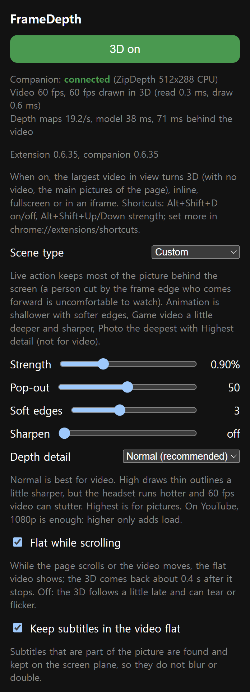

# FrameDepth

Real-time 3D for the video and pictures you watch in Chrome on the **Steam
Frame** headset.

FrameDepth turns the video in an ordinary Chrome window into stereoscopic 3D,
right where it plays: in the page, fullscreen, or in a player embedded from
another site (iframe). With no video, the page's main pictures (a gallery, a
grid of thumbnails) turn 3D instead. Text and the rest of the page stay flat
and sharp, and the 3D follows when you move, tilt or scroll the window.

English | [한국어](README.ko.md) | [日本語](README.ja.md)

<p align="center"></p>
<p align="center"><sub>The left and right eye FrameDepth made from one flat frame, shown in turn. <i>Tears of Steel</i> (c) Blender Foundation, mango.blender.org, CC-BY 3.0.</sub></p>

> **Experimental.** Tested on one Steam Frame (SteamOS 0.4.5); use it at your
> own risk. Stereo 3D can cause eye strain or discomfort for some people: if it
> does, lower the strength or turn 3D off (Alt+Shift+D), and take breaks.

> FrameDepth is an unofficial, independent project. It is not affiliated with
> or endorsed by Valve, Google or any website it works with. Steam, Steam Frame,
> SteamVR and SteamOS are trademarks of Valve Corporation; Chrome is a trademark
> of Google LLC. Other names belong to their owners.

## How it works

Two parts work together on the headset:

- **Extension** (`extension/`, Chrome Manifest V3): finds the video or pictures
  to convert (any site, no per-site rules) and keeps telling the companion
  where they are, and where player controls and captions are drawn over them.
- **Companion** (`companion/`, a systemd user service): reads that part of
  Chrome's window, estimates depth with the ZipDepth model, draws a left and a
  right eye on the GPU and shows them as a SteamVR overlay right over the video.

Nothing leaves the device: the extension talks only to the companion on
`127.0.0.1`, and the companion listens on 127.0.0.1 only and refuses web pages
(it checks the extension's Origin).


<sub>Left: the frame as Chrome shows it. Right: the depth FrameDepth estimated (lighter is nearer). <i>Tears of Steel</i> (c) Blender Foundation, CC-BY 3.0.</sub>

Details: [docs/how-it-works.md](docs/how-it-works.md).

## Features



- The largest video in view turns 3D: in the page, fullscreen, in an iframe
- With no video, the page's main picture or pictures turn 3D
- Player controls, captions and page dialogs are found and kept flat (no
  doubled buttons); Chrome menus and the extension popup stay clean
- Follows curved, flat and tilted windows; while the page scrolls the video
  shows flat and turns 3D again when it stops (can be turned off)
- Black bars in a video (a wide film, a 4:3 show) stay flat; only the picture
  inside them gets depth
- The depth stays within about 1 degree however large or near the window is
- Steadier depth in still scenes, cleaner outlines of near objects
- 3D videos (side by side, top and bottom) are recognised and shown as they are;
  subtitles in the video are kept flat (can be turned off)
- Scene types (Film & live action, Animation, Game video, Photo) set several
  settings at once; save your own values for each, or bring back the defaults
- Popup settings: strength, pop-out, soft edges, sharpen, depth detail (Normal
  and High on the CPU, Highest on the GPU for pictures)
- English, Korean and Japanese

## Requirements

- Steam Frame running SteamOS with SteamVR
- Chrome from Flathub (`com.google.Chrome`)
- Developer Mode, and SSH or a terminal on the headset

FrameDepth installs into your home folder only and needs no `sudo` (SteamOS
keeps its root file system read-only).

## Install a release (on the headset)

Download `framedepth-VERSION-steamos-arm64.tar.gz` and its `.sha256` from
[Releases](https://github.com/guix8/framedepth/releases) to the headset's
Downloads folder, then in a terminal there:

```bash
cd ~/Downloads && f=$(ls -v framedepth-*-steamos-arm64.tar.gz | tail -1) && echo "$f"   # the newest download
sha256sum -c "$f.sha256" && tar -xzf "$f" && cd "${f%.tar.gz}"
bash install.sh                # ~/.local/share/framedepth, user service, extension files
```

Nothing to build. Go on to [Load the extension](#load-the-extension).

## Build from source (on the headset)

Building needs git, curl, cmake, ninja, clang, pkg-config, the X11 (`x11`,
`xext`, `xdamage`), EGL/OpenGL and Vulkan development files on the headset
(aarch64), a network connection (the LiteRT build fetches its dependencies)
and about 0.5 GB of disk.

```bash
git clone https://github.com/guix8/framedepth.git && cd framedepth
bash scripts/fetch-deps.sh     # pinned sources into build-deps/
bash scripts/build.sh          # LiteRT and ncnn once (long), then the companion
bash packaging/install.sh      # ~/.local/share/framedepth, user service, extension files
```

`bash packaging/make-release.sh` packs the build as a release archive in
`dist/`; `bash scripts/fetch-litert-sources.sh && bash packaging/make-source-bundle.sh`
packs the third-party sources it is built from (published with each release).

## Load the extension

1. In Chrome, open `chrome://extensions` and turn on **Developer mode**.
2. Press **Load unpacked** and choose `~/Downloads/framedepth-extension`, the
   folder install.sh copied there (not the `extension` folder in the
   archive). Chrome runs FrameDepth from it, so keep it.
3. Pin FrameDepth in the Extensions (puzzle piece) menu and click it to turn
   3D on (Alt+Shift+D).

In fullscreen, where the popup is out of reach, Alt+Shift+Up and Down change
the strength while 3D is on. Keys for pop-out can be set in
`chrome://extensions/shortcuts`; check there too that FrameDepth got its keys
(Chrome leaves out a key another extension already uses).

**Update:** for a release, download the new archive and run its `install.sh`
again; from source, `git pull`, then `fetch-deps.sh`, `build.sh` and
`packaging/install.sh` again. Then reload FrameDepth in `chrome://extensions`:
the companion changes at once, but Chrome keeps the extension it loaded until
it is reloaded (the popup says so when the versions differ).

**Remove:** first remove FrameDepth in `chrome://extensions` (with its folder
gone first, Chrome shows an error), then run
`bash ~/.local/share/framedepth/uninstall.sh`. If Chrome's Steam shortcut uses
the launcher below, set it back too (uninstall.sh says so). Delete the
downloaded archive and its unpacked folder yourself.

## Recommended: Chrome from Steam's library

Add Chrome to Steam's library as a non-Steam game and start it from there:
the laser then works as a mouse.

- Trigger: left click (hold and drag to select text)
- Thumbstick press: right click
- Thumbstick up and down: scroll (with the helper below)

Started outside Steam, the laser works as touch: dragging scrolls the page
instead of selecting text, and a long press opens Chrome's touch menu instead
of a right click.

Chrome started from Steam needs two fixes, and the launcher installed with
FrameDepth does both:

- **Window size:** Steam opens a 1280×720 window. A 1920×1080 window at 150%
  keeps the layout and text size with 1.5 times the pixels: sharper text, and
  2.25 times the pixels for the 3D (a YouTube player in a page went from
  859×483 to 1289×725).
- **Scrolling:** the thumbstick's scrolling mostly never reaches the page. The
  laser and the scrolling come in as two input devices, and Chrome drops the
  scrolling each time they switch. A small helper sends it again, only while
  Chrome runs.

Set it up once:

1. Add Google Chrome to your library as a non-Steam game, if it is not there yet.
2. In Chrome's **Properties → Shortcut**, set:
   - Target: `"/home/steamos/.local/share/framedepth/steam-chrome/chrome-with-scroll.sh"`
     (change `/home/steamos` if your home folder is another)
   - Launch options: `"/usr/bin/flatpak" run --branch=stable --arch=aarch64 --command=/app/bin/chrome --file-forwarding com.google.Chrome @@u @@`
     (the Chrome command Steam put there, with `"/usr/bin/flatpak"` in front)
3. Close Chrome completely and start it from the library.

- **Window size only** (no helper): keep the target, and put
  `--window-size=1280,720 --window-position=0,0 --force-device-scale-factor=1.5`
  in the launch options right after `com.google.Chrome` (before `@@u @@`).
  `--window-size` is the size before the scale: `1280,720` gives 1920×1080.
- **Undo:** set the target back to `"/usr/bin/flatpak"` and take
  `"/usr/bin/flatpak"` off the front of the launch options.
- **Limits of the helper:** Chrome sometimes takes the original scrolling too
  (about 2%), so it may scroll a little further. If a SteamOS update fixes the
  scrolling, it may scroll twice: undo it then. Starting Chrome from Steam while
  it runs only brings up the running window; the first helper keeps working.

## Troubleshooting

The top of the popup shows whether the companion is connected, why the 3D
does not start, and how it is running.

- *Not connected*: the companion is not running. Check it and start it again:
  ```bash
  systemctl --user status framedepth-companion --no-pager
  systemctl --user restart framedepth-companion
  ```
- *Versions differ*: reload FrameDepth in `chrome://extensions`.
- *Chrome's window is not in SteamVR*: the 3D shows only over Chrome running
  in the headset with SteamVR on (from the dashboard or Steam's library), not
  on a desktop or an external display.
- *In use by another Chrome profile*: one profile at a time. Turn 3D off in
  the other one or close it.
- *Error*: usually the depth model did not start. Restart the companion; if the
  error stays, install again.
- *Nothing happens*: a video must be at least 200×112 pixels, a single picture
  about a fifth of the view, or several pictures at least 120×68 each, and in
  view.
- *Video stutters*: set Depth detail to Normal.

The companion's log tells more:

```bash
journalctl --user -u framedepth-companion -n 50 --no-pager
```

When you report a problem, include the status and version lines at the top of
the popup, that log, and your SteamOS version (Settings → System).

## Tips

- For video, use Depth detail **Normal** (the default) and YouTube at 1080p.
  The companion reads what Chrome draws at window resolution, so 1440p and
  above make the 3D no sharper and only add decoding load. What counts is the
  window: 1920×1080 at 150% (see Chrome from Steam's library above).
- **High** gives finer outlines at about one more CPU core, more heat and a
  depth that trails motion a little more; worn, 60 fps video then fell to
  45-50 fps at times. **Highest** shares the GPU with SteamVR and suits pictures.
- The default strength gives about the depth of a stereo film (0.9% for live
  action). Raise it with the slider for more depth; lower it if your eyes tire.

## Status and limits

Early, tested on one headset. Known limits:

- DRM-protected players work only if Chrome lets their window be read.
- Player controls drawn on a canvas are not found.
- One 3D region per tab.
- While 3D is on, the page's title briefly carries a marker, so pages can tell
  the extension is installed.
- The extension keeps a short diagnostic log in its own storage on the device
  (no site names; never sent anywhere).

See [docs/how-it-works.md](docs/how-it-works.md#limits).

## License

Copyright 2026 FrameDepth contributors. GPL-3.0-only (see [LICENSE](LICENSE)).
FrameDepth builds on GPL-3.0 code and ideas from Moonlight XR (Sean Gilleece)
and its Steam Frame port, Moonlight XR for Frame (simplysanatori), and on the
ZipDepth model (MIT). Third-party components and their licenses:
[THIRD_PARTY.md](THIRD_PARTY.md).
